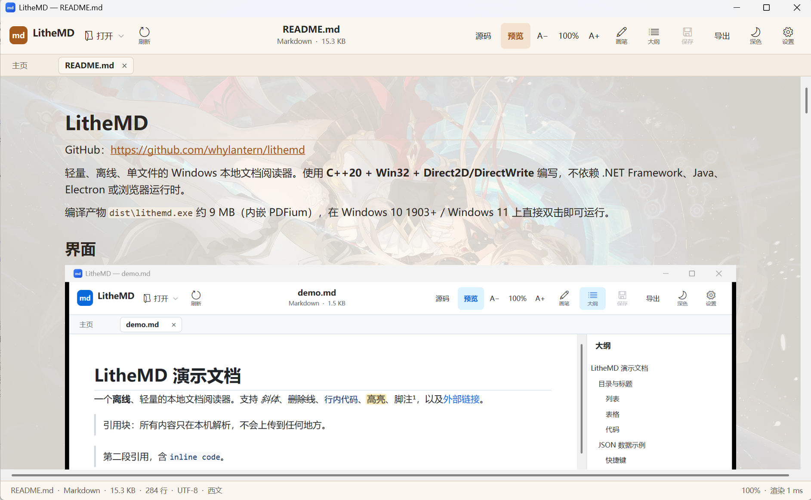

# LitheMD

GitHub：<https://github.com/whylantern/lithemd>

轻量、离线、单文件的 Windows 本地文档阅读器。使用 **C++20 + Win32 + Direct2D/DirectWrite** 编写，不依赖 .NET Framework、Java、Electron 或浏览器运行时。

编译产物 `dist\lithemd.exe` 约 9 MB（内嵌 PDFium），在 Windows 10 1903+ / Windows 11 上直接双击即可运行。

## 界面与背景



## 为什么是 C++

旧版 LitheMD 是 WPF/.NET Framework 4.8 应用。这个版本把窗口、排版、Markdown、LaTeX、Office 和 PDF 阅读全部迁移到原生 C++：

- 启动不检查、不加载 .NET Framework
- 不依赖 SDK、NuGet、Java、Node 或在线服务
- 只使用 Windows 自带组件（Direct2D / DirectWrite / WIC / GDI / Shell）和一个内嵌的 PDFium
- 所有解析、排版、渲染都在本机完成，不发起网络请求

## 系统要求

- Windows 10 1903（2019 年 5 月更新）或更高版本 / Windows 11 / Windows Server 2022
- 64 位系统
- 无需安装任何额外运行库

## 支持的格式

| 格式 | 扩展名 | 显示方式 |
| --- | --- | --- |
| Markdown | `.md` `.markdown` `.mdown` `.mkd` `.mdx` | 富文本排版、代码高亮、表格、图片、大纲、LaTeX 公式 |
| JSON | `.json` `.jsonc` `.geojson` `.webmanifest` `.json5` | 可展开/折叠的 JSON 树 |
| Jupyter Notebook | `.ipynb` | Markdown 单元、代码单元、输出、图片、附件 |
| OpenCode 对话记录 | 含 `info` + `messages` 的 `.json` | 聊天气泡、思考过程、工具调用 |
| CSV / TSV | `.csv` `.tsv` | 可拖动列宽/行高、固定表头、单元格复制 |
| Word 文档 | `.docx` | 标题、段落、列表、表格、图片、超链接、引用 |
| Word 97 文档 | `.doc` | 通过 OLE 复合文档提取正文（兼容模式） |
| Excel 工作簿 | `.xlsx` | 多工作表、共享字符串、数值、布尔值 |
| Excel 97 工作簿 | `.xls` | 通过 OLE/BIFF 解析单元格值（兼容模式） |
| PDF | `.pdf` | 内嵌 PDFium 逐页渲染，按窗口宽度缩放、滚动缓存 |
| ZIP | `.zip` `.cbz` | 条目浏览、文本/图片/Office 条目预览、单条或全部解压；支持 ZipCrypto 与 AES 密码 |
| 图片 | `.png` `.jpg` `.jpeg` `.gif` `.bmp` `.tif` `.tiff` `.ico` `.webp` | 按窗口适配显示，支持缩放 |
| 纯文本 | `.txt` `.log` `.yml` `.yaml` `.xml` `.ini` `.toml` 等 | 等宽源码视图、行号、水平滚动 |

文件类型优先按扩展名判断；无扩展名时根据内容推断 JSON / Markdown / CSV / 纯文本。

以下可执行/系统二进制类型在读取和解码前直接拒绝：

```text
.exe .dll .sys .drv .scr .com .msi .msp .cpl .ocx .efi
.bin .lnk .class .pyc .o .obj .lib
```

PDF、Office 和图片等已支持的二进制文档不受影响。

### 格式实现说明

- **DOCX / XLSX**：直接解析 OOXML 的 ZIP + XML，不依赖 Office 或 Open XML SDK。
- **DOC / XLS**：直接读取 OLE Compound File、Word FIB/片段表和 Excel BIFF8 记录；只提取文本或单元格值，不保留原始分页和样式。
- **PDF**：内嵌 [PDFium](https://pdfium.googlesource.com/pdfium/)（BSD 许可）作为 RCDATA 资源，首次打开 PDF 时解压到 `%LOCALAPPDATA%\lithemd\`。它不依赖 Adobe、Edge 或 .NET。
- **Markdown / LaTeX**：自研 Markdown 块级/行内解析器和轻量 LaTeX 排版器；分式、根式、上下标、矩阵、cases、绝对值、取整括号、`\mid`、`\bmod` 等使用 DirectWrite 实际排版。

## 快速开始

```powershell
# 打开阅读器
.\dist\lithemd.exe

# 打开指定文件
.\dist\lithemd.exe samples\demo.md
.\dist\lithemd.exe samples\sample.docx
.\dist\lithemd.exe samples\sample.xlsx
.\dist\lithemd.exe samples\sample.pdf

# 直接打开设置
.\dist\lithemd.exe --settings
```

把文件拖进窗口，或按 `Ctrl+O` 选择文件。

## 主要特性

- **统一打开菜单**：工具栏和欢迎页只保留一个“打开 ▾”按钮，可选择打开文件或文件夹；`Ctrl+O` / `Ctrl+Shift+O` 仍可直接执行
- **工作区操作**：同一个“打开 ▾”菜单在已有工作区时追加显示/隐藏、刷新和定位当前文件，不再保留单独的右上角入口
- **自适应主页**：欢迎区 + 最近打开/最近工作区卡片；宽屏并排、窄屏纵向；卡片内滚动列表，卡片外滚动整页；过长的目录自动换行；底部显示版本与 MIT 许可
- **多文件标签页**：同时打开多个文档，标签切换；关闭当前文件回到主页
- 浅色 / 深色主题，覆盖正文、代码、表格、JSON 树、PDF 页框、图片、滚动条和设置窗口
- **背景图片**：支持 PNG / JPEG / BMP / GIF / TIFF / WEBP / ICO；透明度 5%–60%（默认 15%）；铺满裁剪、完整显示、拉伸、平铺；铺满时可选择 3×3 裁剪位置；选择后自动复制到配置目录并生成 ID，原图移动或删除不影响背景
- 图片查看、未知格式按文本打开
- 鼠标中键快速滑动：按住中键后，光标离按下点越远，页面沿光标方向滚动越快
- 60% – 250% 缩放，`Ctrl+滚轮` / `Ctrl+=` / `Ctrl+-` / `Ctrl+0`
- 滚轮速度 1–10 档可调，持久化到外部 `config.json`
- 预览 / 源码一键切换（Markdown、JSON、Notebook、对话、CSV、纯文本）
- 代码块和表格单元格悬停显示复制按钮，点击写入剪贴板
- **画笔注释**：以文档为画布，在正文、表格、源码、PDF 和图片上直接书写；支持画笔/橡皮、文字、直线、箭头、矩形、椭圆、颜色、粗细、撤销和清空
- **选择与组合**：以一条笔迹/一个图形/一段文字为单位选择，支持移动、缩放、旋转、复制、粘贴、组合、取消组合和删除
- **笔记保存**：每个文档一个 JSON，保存在 `config.json` 同目录的 `lithemd-notes/`；打开时自动加载，`Ctrl+S` 或顶部“保存”按钮手动保存，不自动保存
- **PDF 文字荧光笔**：拖动框选文字后高亮；扫描版 PDF 自动退化为矩形荧光笔
- Markdown 与 Notebook 标题大纲（`Ctrl+B`），滚动正文时自动高亮当前章节
- **路径输入**：`Ctrl+L` 粘贴文件、文件夹或 ZIP 路径，支持 `%USERPROFILE%`、`~` 和相对路径
- **文件夹工作区**：`Ctrl+Shift+O` 打开文件夹，左侧分层目录树；根目录先显示，后台预加载向下 3 层，展开文件夹再加载向下 3 层，当前目录不截断
- **最近打开**：主页内嵌滚动列表，按 8 条分批加载，最多保留 500 条历史；单条删除、清空和删除黑名单
- **最近工作区**：主页卡片内可滚动查看完整文件夹历史，可直接切换或清空；最近打开和工作区两个卡片各自滚动，互不影响
- **阅读版式**：字号 85%–135%、正文宽度 680–1400，设置持久化
- **文件监听**：外部保存后自动重载；有未保存笔记时先提示
- **阅读位置记忆**：按文档记住滚动位置，下次打开同一文件时恢复
- **ZIP**：浏览条目、预览、解压选中或全部；`ArchiveReader` 防止 Zip Slip、绝对路径和压缩炸弹
- **分屏与演示**：同一文档双栏阅读；`F11` 进入无边框演示，`Esc` 退出
- **富 Markdown**：脚注、GitHub Alerts、emoji、`==高亮==`、`^上标^`、`~下标~`
- UTF-8 默认优先；支持 UTF-8 BOM、UTF-16/32、GB18030/GBK、Big5、Shift-JIS、EUC-KR、Windows-125x、Latin-1、ANSI 手动切换与自动识别
- 文档语言选项（自动/简中/繁中/日/韩/西文）和常见乱码自动修复，可在顶部“编码”菜单调整
- CSV / Excel 单元格选择与 `Ctrl+C` 复制，可拖动列宽和行高
- PDF 逐页渲染、滚动缓存、缩放
- 所有解析与渲染离线完成

## 快捷键

| 快捷键 | 功能 |
| --- | --- |
| `Ctrl+O` | 打开文件 |
| `Ctrl+Shift+O` | 打开文件夹 |
| `Ctrl+L` | 输入文件 / 文件夹 / ZIP 路径 |
| `Ctrl+Shift+E` | 显示或隐藏工作区 |
| `Ctrl+\` | 分屏 |
| `F11` | 演示模式；`Esc` 退出 |
| `Ctrl+W` | 关闭当前文件标签 |
| `F5` / `Ctrl+R` | 重新加载 |
| `Ctrl+1` | 预览模式 |
| `Ctrl+2` | 源码模式 |
| `Ctrl+Shift+A` | 打开/关闭画笔注释 |
| `Ctrl+Z` | 画笔模式下撤销 |
| `Ctrl+Y` | 画笔模式下重做 |
| `Ctrl+S` | 保存当前文档笔记 |
| `Ctrl+V` | 粘贴选中的笔迹 |
| `Ctrl+G` / `Ctrl+Shift+G` | 组合 / 取消组合 |
| `Delete` | 删除选中的笔迹/图形/文字 |
| `Ctrl+Shift+H` | 打开 PDF 文字荧光笔 |
| `Esc` | 退出画笔模式 |
| `Ctrl+B` | 显示/隐藏大纲 |
| `Ctrl+Shift+D` | 切换浅色/深色 |
| `Ctrl+,` | 设置 |
| `Ctrl+滚轮` | 缩放 |
| `Ctrl+=` / `Ctrl+-` | 放大 / 缩小 |
| `Ctrl+0` | 缩放复位 |
| 鼠标滚轮 | 按设置的滚动速度滚动 |
| 按住中键移动 | 快速平滑滑动，距离越远速度越快 |

> 设置 → 快捷键可录制并保存到 `config.json` 的 `shortcuts`。应用命令和文档导航键均可自定义；重复绑定先到先得并提示。`Ctrl+Shift+Z` 和小键盘缩放不是默认键，需要时可自行录制。  
> 笔记文件位于 `config.json` 同目录的 `lithemd-notes/<路径哈希>.json`，只保存当前文档，不写入原文件。

## 配置文件

优先级：

1. `lithemd.exe` 同目录的 `config.json`（便携模式）
2. `%LOCALAPPDATA%\lithemd\config.json`

```json
{
  "theme": "light",
  "zoom": 1.00,
  "fontScale": 1.00,
  "contentWidth": 1040,
  "workspaceHistory": [],
  "workspaceRoot": "",
  "workspaceVisible": false,
  "wheelStep": 3,
  "inkToolsVisible": 87,
  "recent": [],
  "recentBlocked": []
}
```

`inkToolsVisible` 是画笔工具按钮的位掩码，默认 `87`：

| 位 | 工具 |
| --- | --- |
| 0 | 笔 |
| 1 | 擦 |
| 2 | 线 |
| 3 | 箭 |
| 4 | 框 |
| 5 | 圆 |
| 6 | 字 |

默认显示笔、擦、线、框、字；箭和圆收进工具条的“更多”隐藏栏。设置窗口可直接勾选调整，并支持“复制配置”把完整 JSON 写入剪贴板。

首次启动会把旧版 `%LOCALAPPDATA%\openmd` 中的配置、最近记录和笔记迁移到 `%LOCALAPPDATA%\lithemd`。设置窗口可以直接打开、复制路径、复制配置内容或定位配置文件。

阅读位置保存在同目录的 `reading-positions.json`，最多保留 500 个文档；删除文档不会删除原文件，清空本地数据会同时移除该记录。

## “打开方式”和默认应用

设置窗口提供：

- **加入打开方式**：写入当前用户 `HKCU\Software\Classes`、`RegisteredApplications` 和 `App Paths`，让 Windows 的“打开方式 → 更多应用”和“默认应用”识别 LitheMD，无需管理员权限。
- **格式复选列表**：勾选要注册的扩展名；顶部“全选”勾选框可一键全选或全不选，所有格式都勾选时会自动勾选。
- **申请默认应用**：单选格式时调用系统 `SHOpenWithDialog`；多选时调用 Windows 的默认应用权限界面。Windows 8 以后不允许应用静默把自己设为默认，必须由用户在系统界面确认。
- **取消默认关联**：移除 LitheMD 的注册并打开 Windows 默认应用设置；最终切换由用户确认。
- **Windows 默认应用**：打开 `ms-settings:defaultapps` 页面手动调整。

也可以运行 `tools\install-association.ps1` 安装“用 LitheMD 打开”的右键菜单（只写 HKCU，可卸载）。

## 编译

仓库已经内置精简版 **w64devkit 2.11.0 / GCC 16.2.0**（`tools\w64devkit`），不需要安装 MinGW、.NET SDK、Visual Studio、CMake，也不需要联网。

`build.ps1` 是唯一的实际构建脚本。`build.bat` 只是资源管理器双击包装器：它会调用 `build.ps1`，结束后暂停窗口以便查看错误。

推荐：

```powershell
powershell -NoProfile -ExecutionPolicy Bypass -File .\build.ps1
```

也可以直接双击 `build.bat`，适合不熟悉 PowerShell 的用户。

脚本优先使用 `tools\w64devkit\bin` 里的 `g++ / gcc / windres`；也可以传 `-Cxx` 指定外部编译器。输出：

```text
dist\lithemd.exe
```

脚本会编译 `src\*.cpp`、`vendor\miniz.c`，用 `windres` 编译图标、manifest 和内嵌 PDFium。`vendor\pdfium\pdfium.dll` 和 `tools\w64devkit` 必须保留在源码树中。

每次构建前，旧的 `dist` 会以时间戳重命名并归档到 `.old\dist-YYYYMMDD-HHmmss`；`.old/` 已加入 `.gitignore`，不会污染版本库。

## 目录结构

```text
lithemd/
├─ build.ps1 / build.bat      构建脚本 / 双击包装器
├─ app.manifest               DPI / 系统兼容性清单
├─ README.md / LICENSE        说明与许可证
├─ docs/                      全局要求、架构、编辑可行性、版本记录
├─ assets/lithemd.ico          程序图标
├─ samples/                   各格式示例
├─ src/                       C++ 源码
│  ├─ main.cpp                入口
│  ├─ app.cpp                 主窗口、工具栏、设置窗口、文件关联
│  ├─ view.cpp / outline.cpp  文档视图、源码视图、JSON 树、表格、PDF、大纲
│  ├─ workspace_model/view   工作区模型、分层预加载与左侧树
│  ├─ workspace_scan.cpp     后台目录缓存与扫描器
│  ├─ archive_reader/window  ZIP 目录、解密、解压与浏览窗口
│  ├─ path_util / file_watch 路径解析、目录监听
│  ├─ dialogs.cpp             路径、密码、文件夹选择器
│  ├─ file_policy.cpp         不支持二进制类型特判
│  ├─ render.cpp              Direct2D / DirectWrite / WIC 渲染
│  ├─ markdown.cpp            Markdown 解析与代码高亮
│  ├─ latex.cpp               LaTeX → DirectWrite 数学排版
│  ├─ office.cpp              DOCX / XLSX
│  ├─ legacy.cpp / ole.cpp    DOC / XLS 与 OLE 复合文档
│  ├─ pdf.cpp                 PDFium 动态加载与位图转换
│  ├─ zip.cpp / xml.cpp       OOXML 所需的 ZIP / XML
│  └─ common.cpp / json.cpp   编码、配置、JSON
├─ tools/w64devkit/           内置 GCC 16.2.0（仅构建时使用）
├─ vendor/
│  ├─ miniz.c / miniz.h       ZIP/DEFLATE（公共领域）
│  └─ pdfium/                 PDFium DLL、头文件、许可证
└─ dist/lithemd.exe            编译产物
```

## 说明与边界

- 不修改被打开的文件，默认不接管系统文件关联。
- 设置中的“清空本地数据”会删除配置、最近记录和本地缓存，不删除用户打开的文件。
- 远程图片不会自动下载，只显示本地相对路径、`data:` 图片或 Notebook 附件。
- 超大 Markdown / Notebook / 对话记录会自动进入源码模式，避免界面卡顿。
- `.doc` / `.xls` 是兼容读取模式，不保证与 Word / Excel 的排版一致。
- PDF 受密码保护时会提示；当前版本不支持输入密码。
- 文件编辑功能尚未实现，相关技术评估见 [docs/EDITING.md](docs/EDITING.md)。

## 第三方组件

- [PDFium](https://pdfium.googlesource.com/pdfium/)：BSD 3-Clause，用于 PDF 渲染。
- [miniz](https://github.com/richgel999/miniz)：MIT / public domain，用于 OOXML ZIP。
- 示例文件中的 Apache POI 测试文档与工作簿遵循 Apache License 2.0；`samples/02_python.ipynb` 等仅用于展示。

## 许可证

LitheMD 的原始源代码采用 **MIT License**，见 [LICENSE](LICENSE)。

第三方组件、示例文件和内置编译器仍遵循各自的许可证，详见 [THIRD_PARTY_NOTICES.md](THIRD_PARTY_NOTICES.md)。MIT 许可证不改变这些第三方条款。
