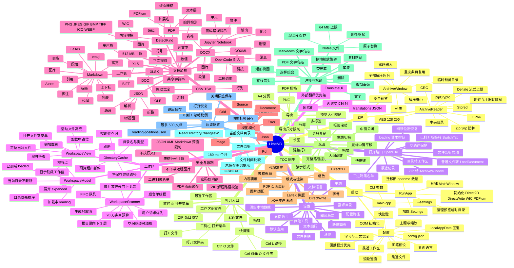

# LitheMD 项目逻辑全景与审查

> 基线：2.4.1.4。本文包含完整业务逻辑思维导图、关键业务流程和代码级审查结论。
> 只描述当前实现，不替代 `docs/ARCHITECTURE.md` 和 `docs/REQUIREMENTS.md`。

## 一、业务逻辑思维导图



## 二、关键业务流程

### 1. 启动

```text
main.cpp
  -> CoInitialize
  -> 解析命令行
  -> RunApp
      -> Engine::Init
      -> 清理 %LOCALAPPDATA%\lithemd\preview
      -> Settings::Load
      -> SetUiLanguage
      -> MainWindow::Create
          -> 创建主页、标签、大纲、工作区
          -> 加载配置中的工作区根目录
          -> 打开命令行传入的文件/文件夹
```

### 2. 打开文件

```text
入口
  工具栏/欢迎页/快捷键/拖放/最近记录/工作区/ZIP 预览
  -> OpenFile
      -> 二进制黑名单检查
      -> 目录 -> OpenWorkspace
      -> ZIP -> OpenArchive
      -> 已在标签中 -> SwitchTab + 文件时间比较
      -> 普通文件 -> 阅读位置还原 + LoadDocument
          -> DetectKind
          -> 文本解码或二进制解析
          -> 创建 Tab + DocView
          -> AddRecent
          -> 文件监听
```

### 3. 打开文件夹 / 工作区

```text
OpenFolderDialog
  -> IFileOpenDialog 选择文件夹
  -> OpenWorkspace
      -> 构建新 WorkspaceModel
      -> 失败保留旧工作区
      -> 根目录直接子项同步显示
      -> WorkspaceScanner 后台预加载 3 层
      -> 保存 workspaceRoot / workspaceHistory
      -> WorkspaceView 显示
```

### 4. 展开文件夹

```text
用户点击文件夹
  -> WorkspaceModel::Toggle
      -> 缓存命中：立即构建直接子项
      -> 缓存未命中：设置 loading，显示“正在加载…”
      -> Scanner 请求该文件夹向下 3 层
      -> UI 定时器把缓存结果填入树
```

### 5. 打开 ZIP

```text
OpenFile(.zip)
  -> ArchiveWindow
      -> ArchiveReader::Open
      -> 条目列表
      -> 预览：读取条目 -> 临时文件 -> OpenFile
      -> 解压选中：读取条目 -> 目标文件
      -> 全部解压：后台线程 + 进度 + 取消
```

### 6. 阅读位置

```text
打开文档
  -> ReadingPositions::Load
  -> DocView::RestoreScrollFraction

切换/关闭/退出
  -> DocView::ScrollFraction
  -> ReadingPositions::Set
  -> 保存 reading-positions.json
```

### 7. 文件变化

```text
FileWatcher
  -> ReadDirectoryChangesW
  -> 180 ms 合并
  -> 主窗口比较文件时间
      -> 无未保存笔记：自动 Reload
      -> 有未保存笔记：标记外部修改
      -> 文件删除：显示错误
```

## 三、代码级审查结论

### 已确认正常

- JSON 嵌套深度上限 512。
- XML 嵌套深度上限 512。
- Markdown 引用块深度上限 64。
- LaTeX 深度上限 128。
- CSV / Excel 限制为 3000 行 × 120 列。
- 笔记文件读取上限 64 MB，写入使用临时文件 + 替换。
- ZIP 单条目 512 MB、总量 4 GB、条目数 100000、压缩比限制。
- ZIP 文件夹条目和文件条目都做路径校验。
- ZIP Deflate 使用输出上限，不再一次性分配完整结果。
- 二进制名单在读取/解码前拦截。

### 高风险问题

| 编号 | 问题 | 影响 |
|---|---|---|
| H1 | `OpenFile` 直接同步调用 `LoadDocument` | 大 Markdown、Office、PDF、图片加载时 UI 卡住 |
| H2 | `ArchiveWindow::Create` 同步读取整个 ZIP | 大 ZIP 打开时窗口无响应 |
| H3 | `PreviewSelected` 同步读取最多 64 MB；`ExtractSelected` 同步读取最多 512 MB | 大条目预览/单条解压卡 UI |
| H4 | `WorkspaceScanner::ScanDirectory` 会把所有子目录一次性放入队列 | 十万级目录会产生大量 `Job` 和路径字符串，缓存预算无法约束队列 |
| H5 | 单个超大目录完整构建 `WorkspaceNode` | 百万级目录/文件仍可能占用数百 MB，甚至 OOM |
| H6 | `WorkspaceView::Paint` 每次绘制都调用 `Rows()` 复制全部可见行 | 展开大量节点后滚动和重绘变慢 |

### 中风险问题

| 编号 | 问题 | 影响 |
|---|---|---|
| M1 | 空闲扫描没有网络盘/可移动盘限制 | 网络共享可能长时间占用磁盘和 CPU |
| M2 | 同一个 ZIP 可打开多个 `ArchiveWindow` | 重复窗口和重复读取 |
| M3 | CLI 路径没有统一走 `ResolveUserPath` | `%USERPROFILE%`、`~`、`file://` 在命令行中不生效 |
| M4 | `Locate` 是同步加载 | 用户主动定位超大路径时仍可能卡顿 |
| M5 | 工作区子目录读取失败显示为空目录 | 用户无法区分“空目录”和“无权限” |
| M6 | `Refresh` 只恢复根目录下一级展开 | 深层展开状态丢失 |
| M7 | PDF 密码只提示错误，不支持输入密码 | 加密 PDF 无法打开 |
| M8 | 文件监听只针对当前活动文档目录 | 非活动标签的外部变化延迟到激活时发现 |
| M9 | 文档加载没有取消机制 | 打开大文件后无法中途取消 |
| M10 | Markdown 行内嵌套强调没有独立深度上限 | 恶意深层 `*` / `~` 标记可能造成递归压力 |
| M11 | 图片已有 1 亿像素硬上限，但仍按原始尺寸解码 | 单张 100 MP 图片理论上约需 400 MB，多标签或背景图会放大内存压力 |
| M12 | 工作区关闭时等待扫描线程 | 网络路径上的 `FindNextFile` 可能延迟退出 |

### 低风险 / 体验问题

- `WorkspaceView` 工作区空闲轮询使用固定 150 ms 定时器。
- 工作区历史最多显示 3 个，但保存 20 个，暂无独立管理窗口。
- 二进制错误仍会创建一个错误标签页，而不是仅弹出提示。
- 预览临时目录在启动时整体清理，多个实例可能互相影响。
- 不支持长路径前缀 `\\?\` 的统一处理。
- 没有单实例保护，重复启动会创建多个进程。

## 四、建议的后续优先级

### P0：异步打开

统一做后台加载任务：

```text
LoadDocument 后台线程
  -> 进度/取消
  -> 完成后 PostMessage 回 UI
  -> 标签先显示“正在打开”
```

同时覆盖：

- ZIP 整包打开
- ZIP 单条预览
- ZIP 解压选中
- PDF/Office 大文件

### P1：控制扫描队列

- `ScanDirectory` 只入队固定数量子目录（例如 32/批）。
- 剩余目录放入 frontier，由空闲任务继续。
- 队列上限与缓存预算分开统计。
- 网络盘/可移动盘默认关闭空闲扫描。

### P2：虚拟化工作区

- 不复制全部 `Rows()`，只绘制可见行。
- 节点只保存名称和父引用，路径按需拼接。
- 大目录仍完整可访问，但内存不随“全部行”复制。

### P3：体验修复

- ZIP 窗口去重。
- CLI 路径解析统一。
- 工作区无权限/读取失败显示错误行。
- 深层刷新策略明确。
- 支持 PDF 密码输入。

## 五、结论

对应的落地方案、改动范围和验收标准见：

`docs/PROJECT-SOLUTIONS.md`

当前项目主链路清晰，最近几版已经补上了：

- 分层工作区预加载
- 无 4000 项截断
- 二进制黑名单
- ZIP 路径安全
- 打开请求排队
- 阅读位置与最近工作区

主要风险已经从“文件能否打开”转移到“大文件/大目录是否阻塞 UI”。下一步应优先做异步文档打开和扫描队列上限，而不是继续增加格式或 UI 功能。
